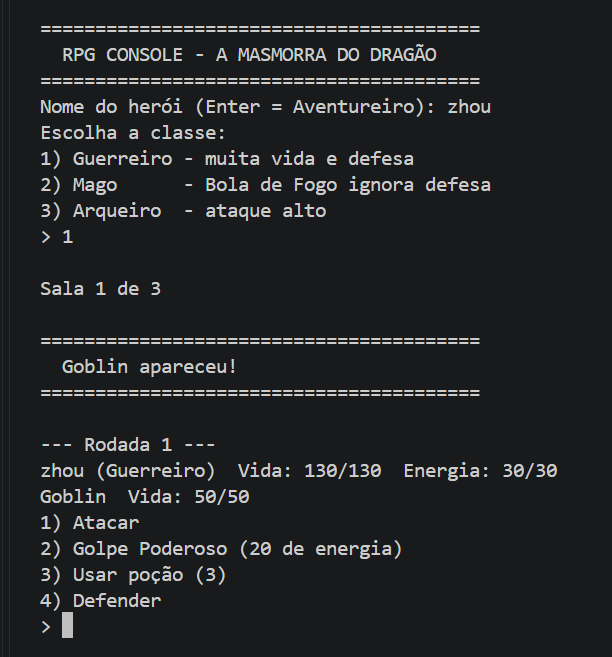
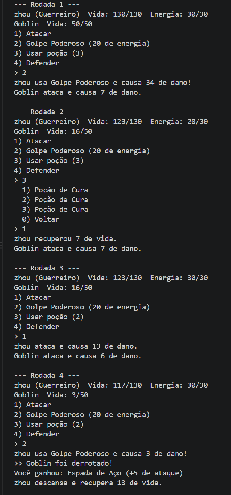
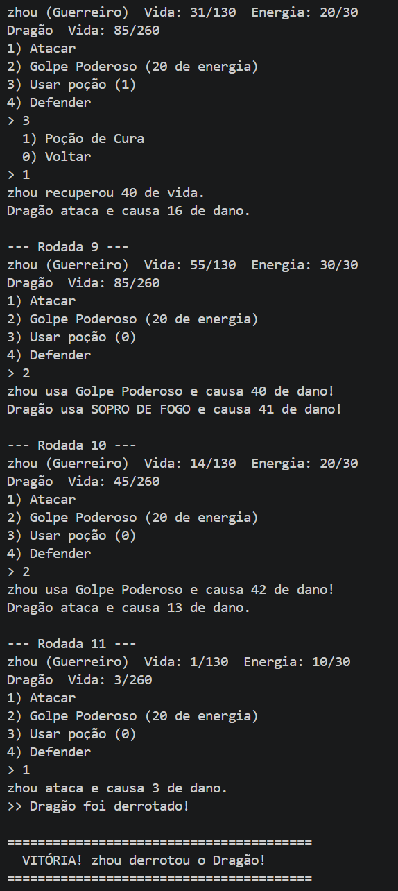

# RPG Console — A Masmorra do Dragão

Trabalho de **Paradigmas de Programação**:RPG feito na linguagem **Java**, usando **Programação Orientada a Objetos** e os **5 princípios SOLID**.

O jogador escolhe um dos tres heróis (Guerreiro, Mago ou Arqueiro) e enfrenta 3 salas: **Goblin**, **Orc** e o chefão **Dragão**. Em cada turno pode atacar, usar a habilidade, usar uma poção e se defender. Depois de vencer, ganha um equipamento e descansa.

---

## Como executar

**Requisito:** JDK 17 ou superior (`java -version`).

### Jeito mais fácil
- **Windows:** dê **dois cliques em `jogar.bat`** (compila e começa o jogo).
- **Linux / macOS:** rode `./jogar.sh`.

### Pelo terminal
```bash
javac -encoding UTF-8 -d out -sourcepath src src/rpg/Main.java
java -cp out rpg.Main
```

### Como jogar
Digite o número da opção e aperte **Enter**.

| Opção | O que faz |
|---|---|
| 1) Atacar | Ataque normal |
| 2) Habilidade | Ataque especial da classe (gasta energia; recupera 10 por turno) |
| 3) Usar poção | Recupera 40 de vida (começa com 3) |
| 4) Defender | Recebe metade do dano no próximo ataque |

---

## Funcionalidades

| Requisito | Como foi feito |
|---|---|
| Personagens com Vida, Ataque, Defesa e habilidades | `Guerreiro` (Golpe Poderoso), `Mago` (Bola de Fogo, ignora defesa), `Arqueiro` (Tiro Certeiro, ignora metade da defesa) |
| Inimigos e combate por turnos | `Goblin`, `Orc` (Pancada Brutal a cada 3 turnos) e o chefão `Dragao` (Sopro de Fogo a cada 3 turnos) |
| Itens / inventário | `PocaoDeCura` (consumível) e `Arma` / `Armadura` (equipáveis); `Inventario` guarda as poções |
| Interface no console | Menus numerados e aviso de opção inválida |

| Classe | Vida | Ataque | Defesa | Energia | Habilidade |
|---|---|---|---|---|---|
| Guerreiro | 130 | 16 | 10 | 30 | Golpe Poderoso: ataque ×2 (20) |
| Mago | 105 | 14 | 6 | 80 | Bola de Fogo: ataque ×2,5 sem defesa (20) |
| Arqueiro | 125 | 18 | 7 | 45 | Tiro Certeiro: ataque ×1,6, metade da defesa (15) |

---

## Estrutura

```
src/rpg/
├── Main.java            # começa o programa
├── Jogo.java            # fluxo da partida (escolher herói, 3 salas, fim)
├── modelo/              # Combatente, Curavel, Personagem, Heroi, Guerreiro, Mago, Arqueiro,
│                        # Inimigo, Goblin, Orc, Dragao
├── habilidades/         # Habilidade + GolpePoderoso, BolaDeFogo, TiroCerteiro
├── itens/               # Item, Consumivel, Equipavel, PocaoDeCura, Arma, Armadura, Inventario
├── combate/             # Batalha, CalculadoraDeDano, CalculadoraDanoPadrao
└── ui/                  # Tela, TelaConsole
```

---

## Conceitos de POO

| Conceito | Onde aparece |
|---|---|
| **Abstração** | `Personagem`, `Heroi` e `Inimigo` são abstratas; `Combatente`, `Habilidade`, `Item`, `Tela` são interfaces |
| **Encapsulamento** | Atributos `private`; a vida só muda por `receberDano()` e `recuperarVida()`, que não deixam a vida ficar negativa nem passar do máximo |
| **Herança** | `Personagem → Heroi → Guerreiro/Mago/Arqueiro` e `Personagem → Inimigo → Goblin/Orc/Dragao` |
| **Composição** | O `Heroi` **tem** uma `Habilidade` e uma lista de `Equipavel`; o `Jogo` **tem** uma `Batalha` |
| **Polimorfismo** | `inimigo.jogarTurno()` muda conforme o inimigo; `habilidade.usar()` muda conforme a habilidade; `Heroi.getAtaque()` soma os equipamentos |

---

## SOLID

### S — Responsabilidade Única
Cada classe faz uma coisa:
- `Batalha` controla os turnos de um combate;
- `CalculadoraDanoPadrao` só calcula o dano;
- `Inventario` só guarda as poções;
- `TelaConsole` só lê o teclado e escreve na tela;
- `Jogo` só cuida do roteiro da partida (salas, recompensas, fim).

### O — Aberto/Fechado
Dá para adicionar coisas novas **criando classes**, sem mudar as que já existem:
- **Nova habilidade:** criar uma classe que implementa `Habilidade`. O `Heroi` e a `Batalha` continuam iguais, porque só chamam `habilidade.usar(...)`.
- **Novo inimigo:** criar uma subclasse de `Inimigo` com o seu `jogarTurno()`. A `Batalha` não muda, porque só chama `inimigo.jogarTurno(...)`.
- **Nova fórmula de dano:** criar outra classe que implementa `CalculadoraDeDano` e passar no `Main`.


### L — Substituição de Liskov
- `Batalha.lutar(Heroi, Inimigo, ...)` funciona com **qualquer** herói e **qualquer** inimigo, sem testar qual é.
- `Heroi.receberDano()` muda o comportamento (metade do dano quando defende), mas termina chamando `super.receberDano()`, então a regra da classe mãe (vida nunca negativa) continua valendo.

### I — Segregação de Interfaces
- `Combatente` tem só o necessário para lutar; `Curavel` fica separada porque **só os heróis** podem ser curados (os inimigos não precisam do método `curar`).
- Itens: `Consumivel` (usar e acabar) e `Equipavel` (dar bônus) são separadas; a poção não precisa de bônus de ataque e a espada não precisa do método `usar`.

### D — Inversão de Dependência
- `Jogo` e `Batalha` dependem das **interfaces** `Tela` e `CalculadoraDeDano`, e não de `Scanner`, `System.out` ou de uma fórmula fixa.
- As implementações são criadas no `Main` e passadas pelo construtor:
  ```java
  Jogo jogo = new Jogo(new TelaConsole(), new CalculadoraDanoPadrao(new Random()));
  ```
- Assim, para trocar o terminal por uma janela gráfica, bastaria criar outra classe que implementa `Tela`.

---

## Capturas de tela

**Início, escolha de classe e primeiro combate (com entrada inválida):**



**Usando poção contra o chefão:**



**Vitória:**



---

## Autor
**Zhou Chen** 
